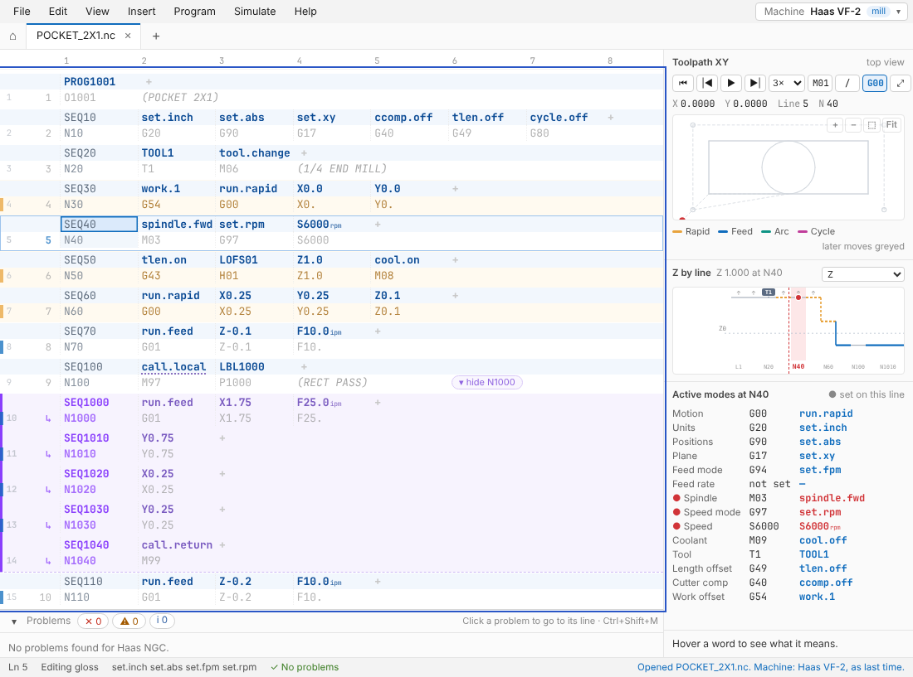
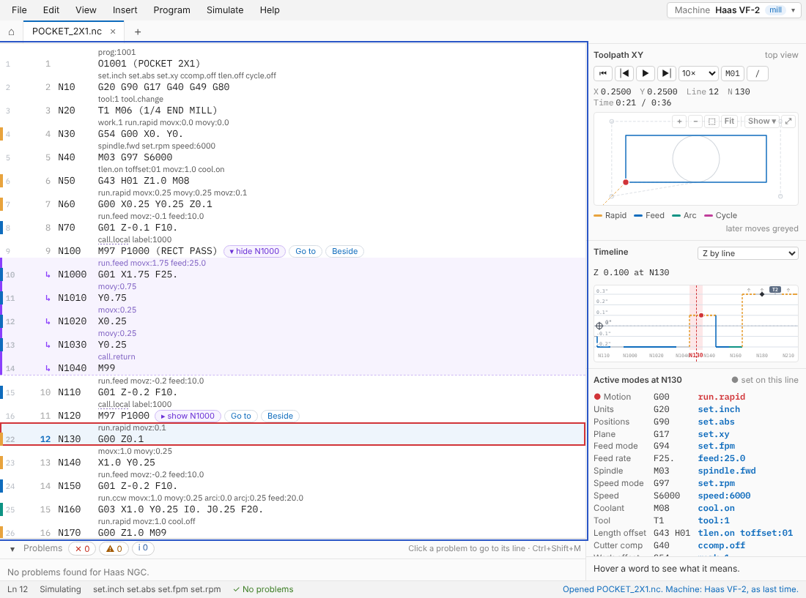
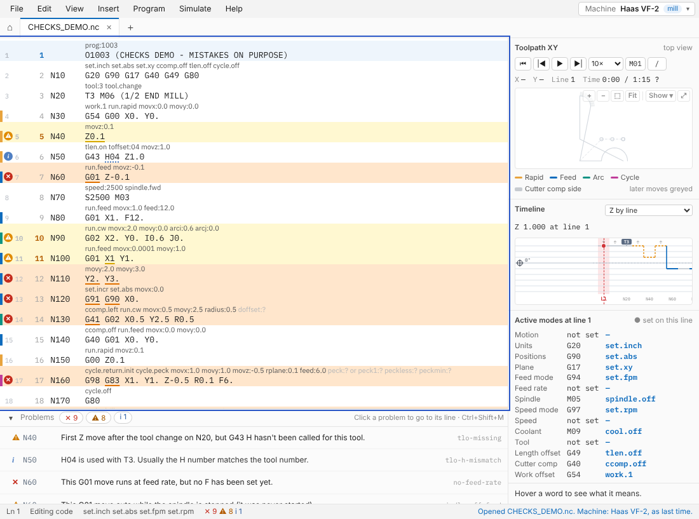
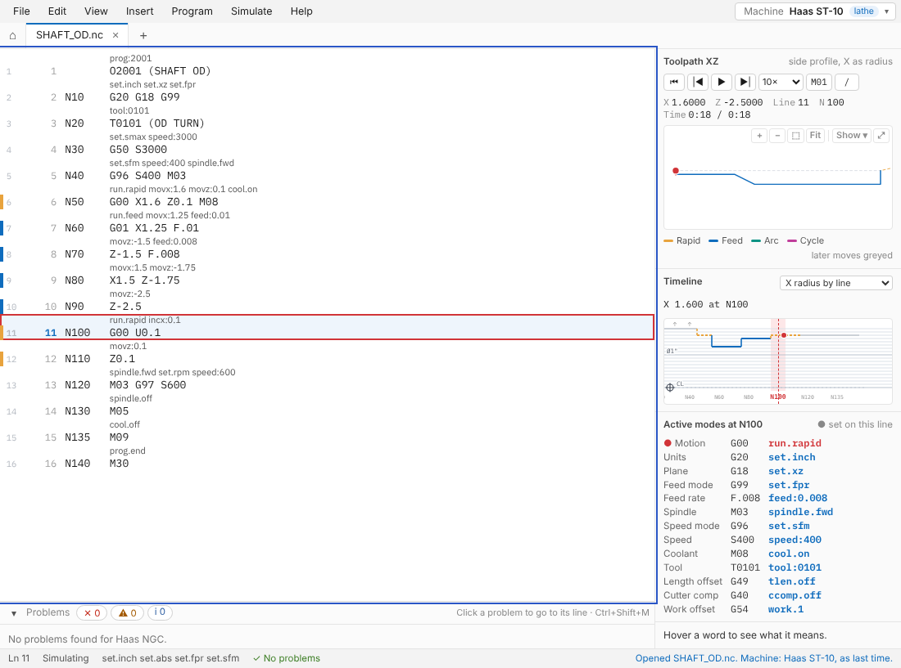
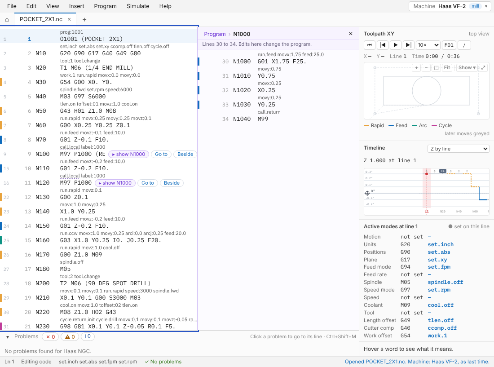
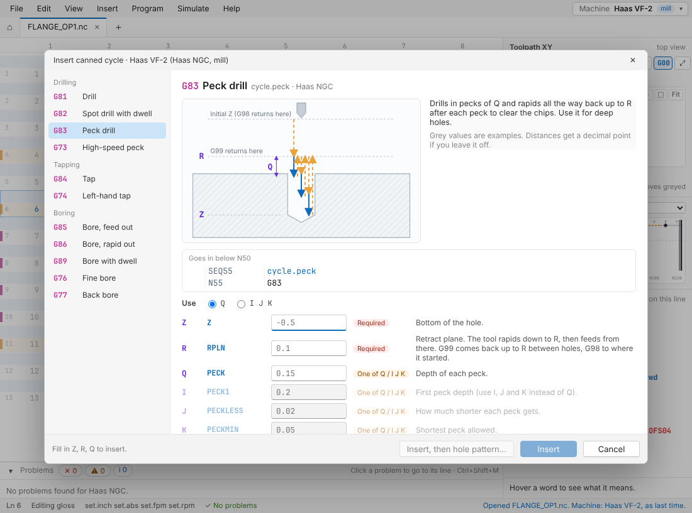
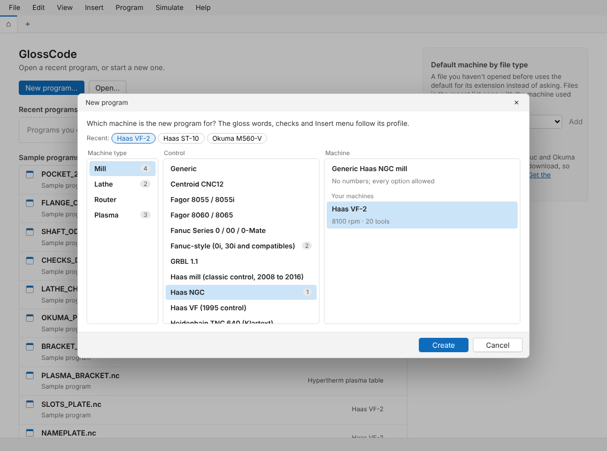
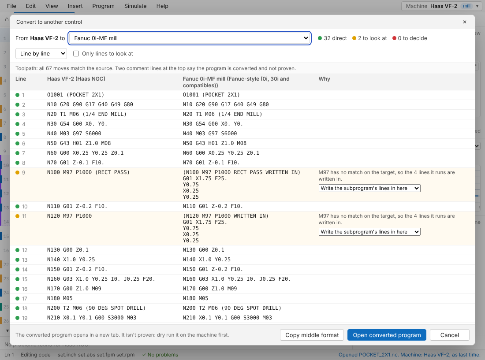

# GlossCode

GlossCode is a G-code editor for CNC mills, lathes and plasma tables. Above every line of code it shows a gloss: a short plain-English reading of what the line does. It also checks the program for mistakes, tracks the active modes, and simulates the toolpath.

**[Website](https://grahamrkf.github.io/glosscode/)** · **[Web app](https://grahamrkf.github.io/glosscode/app/)** · **[Try it with sample programs](https://grahamrkf.github.io/glosscode/try/)** · **[Download for Windows or Linux](https://grahamrkf.github.io/glosscode/download/)**



> **Check every program on the machine before you cut.** GlossCode is new and hasn't been widely tested. It can miss real problems and flag code that's fine. Its tables are only as good as the manuals behind them, and machine builders' options and settings can change what a code does. Prove each program out on the machine itself: run it through the control's own graphics, then a dry run or single block with the feed override turned down.

## What it looks like

Each line of code has its gloss above it in small grey text, and its N number in a column of its own:

```
       spindle.fwd set.rpm speed:6000
N40    M03 G97 S6000

       tlen.on toffset:01 movz:1.0 cool.on
N50    G43 H01 Z1.0 M08
```

Full words like `spindle.fwd` are the default; short words like `SFWD` are under View › Gloss words. How the words are built is in [docs/gloss-words.md](docs/gloss-words.md).

| Simulation | Problems panel |
|---|---|
|  |  |

| Lathe | Subprogram beside the program |
|---|---|
|  |  |

| Insert a canned cycle | New program: pick a machine |
|---|---|
|  |  |

| Convert to another control |
|---|
|  |

## Features

- **Edit like a text editor.** Click a line and type; the gloss follows. Undo, Find (matches code and gloss), auto N numbers and Renumber, tabs for several programs, and the system's own Open and Save dialogs. Files keep their original line endings.
- **Problems panel.** Checks the program as you type: canned cycles missing words, feeds with no F or the spindle off, codes that clash with the active mode, missing decimal points, arcs that don't close, missing length offsets, and codes that mean something else on the selected control. See [docs/checks.md](docs/checks.md).
- **Active modes** for the selected line: motion, units, plane, feed mode, spindle, coolant, tool and offsets.
- **Toolpath and simulation.** XY toolpath (XZ on a lathe) that follows subprogram calls, with zoom and pan. Playback stops at M00 and M01 and can skip block delete lines. The run time is worked out from the programmed feeds and speeds.
- **Timeline** in run order: Z by line (X on a lathe), feed rate or spindle speed, with symbols for drilling, tapping, tool changes and stops.
- **Subprograms.** Calls expand inline, or open in a pane beside the program with Go to and Back.
- **Insert menu.** Canned cycles with a sketch and a box for each word, a hole pattern tool (grid or bolt circle), and a [subprogram library](docs/subprogram-library.md) of reusable subprograms with named variables.
- **Canned cycle guide** (F1): a sketch of how each cycle moves and what every word does.
- **Convert to another control**, matching each code by meaning and checking the result by comparing toolpaths. See [docs/converting.md](docs/converting.md).
- **Machine profiles** for your own machines: spindle and travel limits, options such as live tooling, and the end-of-block `;` for older controls.

The full list, and what may come later, is in [docs/features.md](docs/features.md).

## Supported controls

Checked against programming manuals:

- **Haas**: NGC, classic and 1995 controls, mills and lathes
- **Fanuc**: 0i-F, 0i-D and Series 0, plus Custom Macro B
- **Okuma OSP**: P300M, P200L, E100L, U10L and OSP700L
- **Mitsubishi**: M800/M80 and M700/M70
- **Fagor**: 8055, and 8060/8065 (the lathe still a first draft)
- **Others**: LinuxCNC, Tormach PathPilot, GRBL, Centroid CNC12, Mazak EIA/ISO, Hurco WinMax (ISNC), Siemens SINUMERIK ISO mode
- **First drafts, not yet verified**: Heidenhain TNC 640 Klartext, Hypertherm Phoenix/EDGE plasma

How sure we are of each is in [docs/manual-reviews/control-confidence.md](docs/manual-reviews/control-confidence.md), and what each one doesn't handle yet or isn't sure of is listed in [docs/control-status.md](docs/control-status.md). **Any other control hasn't been checked against a manual.** GlossCode uses generic Fanuc-style rules for those, which may not match what your control does.

**Run one of these controls, or have its manual?** Each has an open [help-wanted issue](https://github.com/grahamrkf/glosscode/issues/114) listing what's uncertain and what to test. A short test report or a quote from a manual helps a lot.

## In a browser

- **[Web app](https://grahamrkf.github.io/glosscode/app/)**: GlossCode in the browser, for your own programs. It opens and saves files on your computer, read and written by the same C core as the program (built as WebAssembly), so unchanged lines are kept byte for byte. In Chrome and Edge, Save writes back to the file you opened and the app can be installed and opens `.nc` files; in Firefox and Safari, Open reads a copy and Save downloads one. Settings, machine profiles and your subprogram library are kept in the browser. It works offline once opened, and nothing you open leaves your computer.
- **[Try it](https://grahamrkf.github.io/glosscode/try/)**: the same screen with sample programs built in. Open a sample from the home page, click a line to edit it, press F5 to simulate, and F1 on a canned cycle to see how it works. Open shows a pretend file list and nothing is saved to your computer.
- **Your own server**: each release has `GlossCode-<version>-web.zip`, the web app as plain files. Unzip it into any folder a web server serves over HTTPS; see the [download page](https://grahamrkf.github.io/glosscode/download/#web).

## For developers

GlossCode is a small core in portable C with the screen in HTML and JavaScript, shown in a native webview (WebView2 on Windows, WebKitGTK on Linux). The same screen runs in a browser, where the web app runs the core built as WebAssembly.

- [CONTRIBUTING.md](CONTRIBUTING.md): getting started, the test loop and the rules for adding codes
- [docs/where-to-change.md](docs/where-to-change.md): which file to change for the usual jobs
- [docs/building.md](docs/building.md): building and testing on Windows and Linux
- [docs/architecture.md](docs/architecture.md): how the parts fit together
- [docs/machine-definitions.md](docs/machine-definitions.md): machine and control definition files
- [docs/releasing.md](docs/releasing.md): versions, installers and portable copies

| Folder | What's in it |
|---|---|
| `src/core/`, `src/platform/` | The C core and the per-OS platform files |
| `src/app/` | The program: webview window and bindings to the core |
| `src/ui/` | The screen (HTML, CSS and JS) |
| `src/web/`, `site/` | The web app's bridge and core build, and the website's landing and download pages |
| `data/` | Gloss dictionary, check rules, one file per control (`data/controls/`) and the built-in subprogram library |
| `examples/` | Sample programs (a separate download, not built into the program) |
| `tests/` | Core tests, UI tests and golden files |

## License

[MIT](LICENSE)
